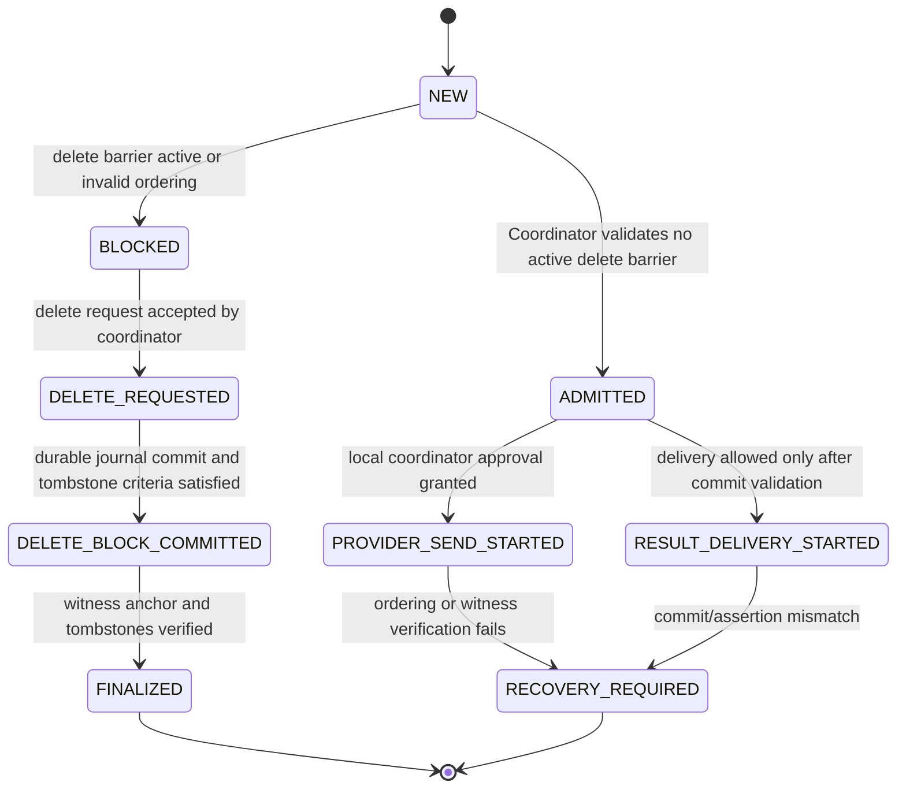

# Jarvis Memory Architecture v3.4

Status: design review only

This document is a unified architecture specification for Jarvis memory coordination, deletion safety, witness anchoring, and metadata privacy. It supersedes and incorporates the decisions made in v1.0 through v3.3 without weakening any existing guarantee. It is not implementation authorization, test authorization, or simulation authorization. Phases A and B remain blocked until the blocking issues in this document are resolved by the responsible decision-maker.

## 1. Scope and design constraint

This specification covers:

- durable ordering and coordination between local state, the Coordinator Journal, and external witness anchoring;
- safe handling of delete requests and deletion-related admission decisions;
- rollback and restore behavior after crash, restart, or stale system image restoration;
- witness anchoring requirements and recovery policy;
- metadata privacy and unlinkability obligations;
- explicit separation between provider-side send initiation and user-visible result delivery.

This specification does not authorize:

- implementation work;
- Phase A or Phase B activation;
- live tests against real data or real credentials;
- schema changes or database migration work;
- production deployment or simulation outside a reviewed design process.

The architecture is intentionally fail-closed: when order, witness validation, tombstone proof, or key-generation proof cannot be established, the system must refuse a user-visible success path and remain in a safe blocked or recovery state.

## 2. Normative principles carried forward from v1.0 through v3.3

The following are mandatory invariants. They are not optional choices and must remain valid in v3.4.

1. Single ordering authority
   - The Coordinator Journal is the only durable ordering authority for admission and deletion decisions.
   - No local component may invent or infer a committed ordering that is not durably recorded in the Coordinator.

2. No proof from STARTED alone
   - `PROVIDER_SEND_STARTED` means the provider has been instructed to start a send, not that the external transfer succeeded.
   - `STARTED` is a logical event in the local orchestration flow, not proof of delivery or success.

3. Separate send from result delivery
   - Provider-side dispatch and user-facing result emission are distinct stages and must be evaluated independently.
   - A send may be accepted or started without implying authorization for user-visible completion or deletion finalization.

4. Delete is fail-closed
   - A delete request does not become final until the durable ordering record, tombstones, witness anchor, and key-generation restrictions are validated.
   - If any dependency is unresolved, system behavior must remain blocked or require manual recovery review.

5. Witness-first rollback protection
   - A local “blocked” or “deleted” state is not rollback-resistant unless it is backed by a durable external witness record.
   - Without a valid witness anchor, older images or stale state can be restored and must be treated as unsafe.

6. Tombstone and generation safety
   - Tombstones must remain durable and unambiguous.
   - Old key generations and historical receipts cannot authorize reactivation after a deletion or block event.

7. Metadata minimization and unlinkability
   - Persistent records must avoid personal data and minimize metadata that can enable linkage, timing inference, and event correlation.
   - Event metadata is considered part of the threat surface even when content is deleted.

8. Recovery required when order is uncertain
   - If the ordering of an event cannot be proven or is inconsistent across stores, the system must require recovery review rather than proceed with user-visible completion.

## 3. System model

### 3.1 Components

- Coordinator Journal
  - durable source of truth for event ordering and commit sequence;
  - stores admission state transitions; commit sequence is assigned only when a committed event is durably recorded.

- Coordinator Admission State
  - local durable state representing whether a request is allowed, blocked, pending recovery, or deleted from the visibility perspective;
  - it is not a second authority for ordering; it is just the Coordinator's durable state machine view.

- Egress Broker / Provider Send Layer
  - receives the send request after the Coordinator has accepted the request in the correct order;
  - may track `PROVIDER_SEND_STARTED` but not claim success merely because it started.

- Result Delivery Layer
  - responsible for user-visible transmission or completion status;
  - must be gated by validated commit state and not by a local-only “started” signal.

- Witness / External Anchor
  - external rollback-resistant evidence of ordering and finalization;
  - required before final deletion semantics are trusted beyond local state.

- Key Store / Key Generation Ledger
  - stores active and retired keys or generations;
  - must enforce generation invalidation and refuse historical keys that are no longer valid for the blocked or deleted state.

- Deletion Ledger / Tombstone Store
  - durable registry of tombstones and delete-related state transitions;
  - supports finalization checks and recoverability without exposure of private data.

- Visibility Gate
  - final authorization step before an object, key material, or related state becomes visible or can be considered deleted in a user-visible sense.

### 3.2 Operational invariants

- Only the Coordinator may assign a committed ordering token.
- A delete request is not final until its ordering and witness proof are both valid.
- `STARTED` is a boundary marker for orchestration, not an end-state proof.
- Old backups and stale local state are untrusted unless they pass current witness and tombstone validation.
- Privacy requirements remain enforced independently of local processing success.

## 4. Atomic Coordinator Admission

### 4.1 Problem statement

A race exists when the following three operations compete in parallel:

- `PROVIDER_SEND_STARTED`
- `RESULT_DELIVERY_STARTED`
- delete request admission or delete finalization

If the system performs these decisions in separate stores or phases without a single coordination point, a stale worker can observe a pre-delete state and continue starting sends even though the delete decision has logically become active.

This is not merely a local lock bug; it is an ordering problem across durable state machines.

### 4.2 Required atomicity model

The system must implement a single linearization point for all competing decisions related to the same logical request or object. The linearization point is the durable commit record in the Coordinator Journal, not the local application memory or a best-effort database write.

The required sequence is:

1. A request enters the Coordinator.
2. The Coordinator evaluates the current admission state and delete barrier.
3. A single durable record is committed with a monotonic `commit_sequence` and a state transition result.
4. Only after durable commit may the Egress Broker or Result Delivery Layer act on that state.
5. Any competing request that does not achieve the same linearization point is rejected or placed in recovery.

This is the required linearization point: the durable state transition must be visible in the Coordinator before any downstream send or delivery action may proceed.

### 4.3 Lock, CAS, and transaction boundaries

The following are distinct mechanisms and must not be conflated:

| Mechanism | Purpose | Authority | Scope | Guarantee |
|---|---|---|---|---|
| Local process lock | serializes local work within one process | local runtime | non-durable, process-scoped | prevents in-memory races only |
| Coordinator CAS / compare-and-set | decides whether a state transition is legal under current durable state | Coordinator | single durable record / state row | enforces linearization in the durable coordinator |
| Coordinator transaction | atomically writes state transition and associated journal entry | Coordinator | single durable transaction boundary | makes state transition durable and visible as one unit |
| Multi-store atomic transaction | not assumed across local DB, external witness, and broker state | none | distributed | unavailable by default; should not be treated as required for correctness |

Important: a local lock or CAS on a single row is not a universal distributed atomic commit. It is only valid within the Coordinator's durable state machine. The system must treat other stores as eventually consistent and not assume they share the same commit boundary.

### 4.4 Required state machine for Admission Decision

### 4.5 Pre-commit and post-commit crash behavior

Pre-commit crash:

- The Coordinator has not durably committed the state transition.
- The request remains in a pending or rejected state.
- No downstream send or delivery action may rely on it.
- Recovery must re-read the durable journal and determine the last committed state before re-arming.

Post-commit crash before downstream action:

- The Coordinator has durably committed the state change.
- The action may be retried or resumed only if replay logic can prove that the state still matches the committed order.
- If replay cannot prove the same ordering, the system enters `RECOVERY_REQUIRED` rather than continuing.

Crash after provider started but before witness validation:

- `PROVIDER_SEND_STARTED` is not proof of success.
- The system must not convert a started send into a completed or deleted state without proof of durable ordering and witness validation.

Crash after delete request but before witness anchor:

- The delete request remains blocked or pending.
- A stale local image must not be allowed to restore deletion visibility without witness and tombstone checks.

### 4.6 Recovery rule

When the system cannot prove a consistent order across the journal, broker, and witness, it must transition into `RECOVERY_REQUIRED` and deny user-visible completion. Recovery is not “retry with optimism”; it is a structured revalidation of the durable coordinator state and the witness records.

## 5. Rollback and restore protection

### 5.1 What local state can guarantee before Witness Anchor

Before a valid external witness anchor is present, the system can guarantee only local process ordering and local durable journal state. It cannot guarantee rollback resistance against stale backups, replays, or restored system images.

The following are not guaranteed before witness anchor:

- historic delete state is irreversible;
- stale restored images cannot resurrect visibility;
- local “blocked” state is safe against rollback;
- key generations cannot be reactivated from old snapshots.

### 5.2 What is protected after witness anchor

After successful witness anchoring and durable tombstone validation, the system can treat the delete or block decision as externally confirmed. This permits stronger assumptions:

- the state is not merely local opinion;
- the ordering is recorded in a rollback-resistant external anchor;
- stale images can be detected and rejected by witness and tombstone checks.

### 5.3 Restore of an old system image

A restored old image is treated as untrusted unless all of the following are valid:

1. The image is reconciled against the current Coordinator Journal.
2. The delete or block state is consistent with the current tombstone ledger.
3. A valid Witness Anchor for the relevant event is present.
4. Active key generations and tombstones match the committed state.
5. The Visibility Gate verifies no stale state is exposed.

If any check fails, the restored image must be rejected or quarantined. It must never automatically reopen visibility or re-enable previous key generations.

### 5.4 Visibility Gate constraints

The Visibility Gate must not open while any of the following remain unresolved:

- tombstone verification incomplete;
- witness verification missing or stale;
- key generation mismatch or historical key use still possible;
- delete ledger state inconsistent with current Coordinator state;
- order ambiguity in the coordinator commit sequence.

The gate is intentionally fail-closed: unresolved contradictions still block visibility even if a local state says “deleted” or “blocked.”

### 5.5 Witness unavailability and verification failure

If the witness is unavailable, stale, or cannot be verified:

- the system must not treat local delete state as final;
- no user-visible reactivation or deletion completion may proceed;
- the request must remain in a safe blocked or recovery state until validation succeeds or a reviewed recovery process is authorized.

This is a mandatory operational requirement, not an optional fallback.

## 6. RPO and Witness Anchoring

### 6.1 Required policy before Phase B

This document does not define arbitrary numeric values for RPO or witness frequency. Any numeric threshold must be explicitly approved by the user or product owner before Phase B. Until that decision is made, the architecture remains blocked by the following requirement:

- BLOCKER: RPO target, maximum uncommitted event window, and witness anchor interval must be defined by user decision before proceeding beyond design review.

This is not a placeholder. It is a required decision gate.

### 6.2 Required characteristics of the policy

The policy must define:

- the maximum allowed staleness between durable journal records and witness anchors;
- the maximum number of unanchored events permitted before a safe block is triggered;
- the recovery behavior when the anchor interval is exceeded;
- the re-entry criteria after witness outage or lag;
- the minimum proof required before a delete is considered final.

Without these definitions, the system has no measurable RPO boundary and cannot safely decide whether it is within acceptable recovery risk.

### 6.3 System behavior on threshold breach

When the maximum uncommitted window or anchor interval is exceeded:

- the affected state must be treated as unsafe;
- no further user-visible completion may proceed;
- the system enters blocked or recovery state;
- existing tombstones and admission decisions are revalidated against witness and key-generation state;
- the next action is a controlled recovery review, not automatic completion.

### 6.4 Witness outage behavior

If witness anchoring is unavailable or delayed beyond the allowed threshold:

- the system remains fail-closed;
- local events may remain queued or blocked but not completed;
- the delete or admission decision remains pending or recovery-required;
- no “good enough” local state may substitute for witness proof.

## 7. Metadata privacy and threat model

### 7.1 Threat model

Metadata is a privacy risk even when raw content is deleted. The system must assume an attacker can see or infer the following from persistent records or timing patterns:

- exact or approximate event timestamps;
- frequency of events or anchor creation times;
- event rarity or correlation with external sources;
- file size and event payload characteristics;
- counts of tombstones, key generations, or delete records;
- ordering gaps or recovery events that reveal operational behavior.

Potential threats include:

- linkage of a deleted event to a user or device by observation of metadata patterns;
- correlation through rare events, timestamps, and frequency analysis;
- re-identification via restored or stale state snapshots;
- inference of the timing of deletions or anchor events from ledger structure or witness cadence.

### 7.2 Required privacy baseline

The architecture requires a privacy baseline that defines what metadata is allowed to persist and what must be omitted, minimized, or transformed. The baseline must exclude or minimize:

- direct personal identifiers;
- precise event timestamps unless required and justified;
- content-derived metadata that can reveal user identity or intent;
- shared linkage fields across deletions and generated keys;
- predictable ordering patterns that could enable timeline reconstruction.

This is a design requirement, not a claim of achieved privacy.

### 7.3 Measurable privacy metrics

Metadata privacy must be evaluated using testable metrics before claiming compliance. The following are minimum categories to define:

- linkage risk under a known adversary model;
- event uniqueness and re-identification rate;
- timestamp precision and inference leakage;
- witness timing correlation leakage;
- tombstone and key-generation analysis risk;
- difference between baseline and observed exposure after deletion.

Because this is a design-only document, no privacy claim is made without empirical evaluation.

### 7.4 Sample size, confidence, and acceptance criteria

The following must be fixed before implementation and testing:

- dataset size or synthetic sample set used for evaluation;
- sample composition and scenario coverage;
- confidence level for the privacy estimate;
- acceptance thresholds for re-identification, linkage, and timing inference risk;
- measurement procedure and required repeatability.

Important: there is no claim of privacy compliance until these values are fixed and evaluated on a representative sample set.

### 7.5 Required blocker

- BLOCKER: the privacy baseline, threat model, evaluation dataset, confidence level, and acceptance thresholds must be defined before any claim that metadata privacy is satisfied.

Until then, the design must remain in a “privacy not validated” state.

## 8. State and recovery tables

### 8.1 Core lifecycle states

| State | Meaning | Allowed next states | Fail-closed behavior |
|---|---|---|---|
| NEW | request created but not yet admitted | ADMITTED, BLOCKED, RECOVERY_REQUIRED | no downstream action allowed |
| ADMITTED | Coordinator accepted the request in durable order | PROVIDER_SEND_STARTED, RESULT_DELIVERY_STARTED, BLOCKED | must maintain journal proof |
| BLOCKED | request or object is blocked due to delete barrier or ordering uncertainty | DELETE_REQUESTED, RECOVERY_REQUIRED | no send or delivery may proceed |
| DELETE_REQUESTED | delete requested and barrier is being enforced | DELETE_BLOCK_COMMITTED, RECOVERY_REQUIRED | no visibility gate open |
| DELETE_BLOCK_COMMITTED | durable delete barrier record committed | FINALIZED, RECOVERY_REQUIRED | witness and tombstones still required |
| FINALIZED | witness and tombstones validated | [terminal] | safe final state only |
| RECOVERY_REQUIRED | ordering or witness proof cannot be validated | blocked recovery path only | no completion or visibility |

### 8.2 Crash and recovery matrix

| Failure point | System state | Required action | Safe outcome |
|---|---|---|---|
| Before durable commit | uncommitted request | replay or reject | no action |
| After durable commit, before send start | committed but unexecuted | resume or replay only if state still matches journal | no optimistic completion |
| After send start, before witness | started but not proven | continue only in recovery-checked mode | no user-visible success |
| After delete request, before witness | pending delete | block and validate tombstone + witness | no visibility gate |
| After witness anchor, before finalization | anchored but not finalized | verify tombstones and key generations | continue only if consistent |
| After restore of stale image | stale state | quarantine or reject restored state | no reactivation |

## 9. Guarantees, assumptions, and open decisions

### 9.1 Established guarantees

These are design decisions that remain in force from previous versions and are retained in v3.4:

- single ordering authority in the Coordinator Journal;
- `STARTED` is not proof of success;
- failure is fail-closed when order is uncertain;
- delete requires witness and tombstone validation before finality;
- restore of stale state must be rejected unless current witness and tombstone checks succeed;
- metadata privacy is treated as a first-class risk requiring minimization and validation.

### 9.2 Assumptions

These are assumptions that remain necessary for the design but are not proof:

- the Coordinator can maintain a durable, monotonic sequence for state transitions;
- witness anchoring is available or can be made available before Phase B;
- key generation and tombstone records can be checked during recovery;
- stale old images can be detected by comparing current journal and witness state.

### 9.3 Open decisions that remain blockers

The following must be resolved before implementation can be authorized:

1. exact atomic Admission Decision logic and linearization proof;
2. witness selection and trust model;
3. acceptably safe RPO and anchor interval values;
4. numeric privacy metrics, test sample, and confidence thresholds;
5. mandatory recovery process for blocked or stale restored images.

These are documented as explicit blockers, not hidden assumptions.

## 10. Required blockers before any implementation

The following are mandatory blocking conditions and must remain in the design review state until resolved:

- BLOCKER 1: The atomic Coordinator Admission Decision and its linearization point must be specified in a single durable state transition, not inferred from separate checks.
- BLOCKER 2: No local blocked state may be considered rollback-resistant until witness anchor validation is complete.
- BLOCKER 3: RPO target, uncommitted-event ceiling, and witness anchor cadence must be approved before Phase B.
- BLOCKER 4: Metadata privacy baseline, sample size, confidence level, and acceptance thresholds must be fixed before claiming privacy compliance.
- BLOCKER 5: No implementation is authorized while restoration safety, tombstone validation, or key-generation invalidation remains unresolved.

## 11. Final status

This version is a unified v3.4 architecture specification. It incorporates the earlier v1.0 through v3.3 guarantees and makes the required blocking issues explicit rather than silent. It is not a final implementation specification, not a permission to begin execution, and not a statement that the system is ready for A/B activation.

The design remains paused until the blockers above are resolved and the responsible authority approves the required decisions.
